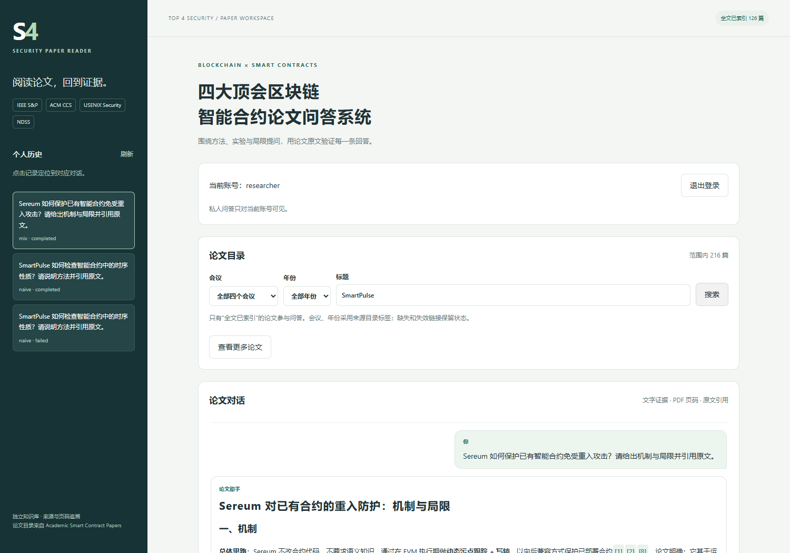
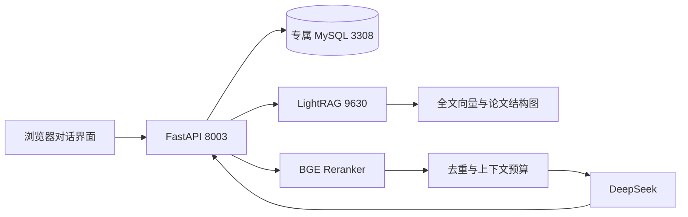

# 四大顶会区块链智能合约论文问答系统

基于 **LightRAG + FastAPI** 的独立论文阅读与证据问答应用，支持中文提问、`naive` / `mix`、BGE 重排、PDF 页码引用、个人对话历史和账号隔离。

论文来源为 [Academic_Smart_Contract_Papers](https://github.com/hzysvilla/Academic_Smart_Contract_Papers) 的前四个安全会议分区：**IEEE S&P、ACM CCS、USENIX Security、NDSS**。来源固定在 `aede99b97104f2f1dd447922d9b54902a89c81d9`。原目录 217 条，标题去重后 216 篇，本次取得 **126 篇可解析全文**（S&P 29、CCS 29、USENIX 39、NDSS 29）；另有 32 篇缺少可用全文链接、57 篇链接不可用、1 份单页海报未入库。未取得全文的条目不会冒充已读论文。

本机已验收索引：**4,349 个全文片段、4,490 个结构图节点、4,601 条边**。构建回执见 [data/index_receipt.json](data/index_receipt.json)。



## 功能

- 对话界面；点击个人历史定位到相应问答，刷新读取已保存结果，不重新调用模型。
- 会议、年份和标题目录筛选；区分目录存在、全文解析完成和索引验收完成。
- 两条检索链路：`naive` 向量检索；`mix` 图与向量混合检索。一次提问只执行所选模式。
- 召回后按会议/年份筛选，BGE Reranker 重排，再去重与选择上下文；重排失败时记录降级并回退原顺序。
- 答案引用关联论文标题、会议、年份、PDF 文件页码和原文片段，可打开本机 PDF。
- Argon2 密码哈希、HttpOnly Cookie、来源校验、个人历史权限控制；账号级幂等，复用同一操作的已保存结果。
- `processing / completed / failed` 短事务记录，区分检索、生成、数据库保存失败；刷新或超时不会被解释为“没有答案”。

## 架构与范围



全文用 BGE-M3 计算 1024 维向量；按 PDF 页面切分，每片最多 1200 token，同页重叠 100 token。结构图通过 LightRAG custom KG 导入论文、会议、年份和页内片段关系，**没有逐段调用生成模型抽取漏洞语义实体**。`mix` 运行图检索，但不意味着效果必然优于 `naive`；本项目不宣称已证明这种图在全部论文问题上有效。

检索请求最多 40,000 token；业务层最多选 8 个片段、30,000 字符。这两个预算单位不同。会议/年份筛选发生在召回之后，因此范围内没有召回结果，不能证明整个范围无答案。当前提取 PDF 文本，不提供图片、复杂公式的视觉理解保证。

## 运行

需要 Python 3.11、Docker Desktop Linux 引擎、可调用的 Embedding / Rerank / 回答模型账户。已建库的本机用户直接按 [操作手册](docs/操作手册.md) 启动，**不用每天重新建库**。

首次安装：

```powershell
git clone https://github.com/yaowcui-ai/Top4Sec-SmartContract-RAG.git
Set-Location Top4Sec-SmartContract-RAG
py -3.11 -m venv .venv
.\.venv\Scripts\python.exe -m pip install -r requirements-lock.txt
.\.venv\Scripts\python.exe scripts/init_config.py
```

填写本机生成的 `.env` 与 `.lightrag.env`，供应商模板见对应 `.example` 文件。配置必须放在后端；不要将密钥、实际密码提交 GitHub。

回答与重排默认不继承桌面代理；确需使用环境代理时，设置 `PROVIDER_TRUST_ENV=true`。本地 LightRAG 请求始终直连。代理出现 TLS/大请求中断时先核对传输链路，不改动检索结果来掩盖生成失败。

```powershell
.\.venv\Scripts\python.exe -m app.corpus collect --workers 4 --resolve-missing
.\scripts\build-index.ps1
docker compose --profile full up -d --build
```

索引构建需要模型调用和时间；可获取全文数量随公开链接变化。看见 `VERIFIED` 后才表示本次构建完成。原始 PDF、正文、向量索引与账号数据库不随源码分发，需要在本机获取和构建。公开回执只记录作者的历史验收，本机就绪还要求不公开的构建标记和完整论文文件；新克隆不会因历史回执显示“已建库”。

访问 **http://127.0.0.1:8003/**，默认用户名 `researcher`，初始密码查看私有 `.env` 的 `APP_ADMIN_PASSWORD`。仅绑定本机；GitHub 源码仓库不是云端问答服务。

日常全 Docker 启动与关闭：

```powershell
docker compose --profile full up -d
docker compose --profile full stop
```

也可让 Docker 运行 MySQL/LightRAG，PowerShell 运行后端：

```powershell
docker compose --profile full stop app
docker compose up -d mysql lightrag
.\.venv\Scripts\python.exe -m uvicorn app.main:app --host 127.0.0.1 --port 8003
```

后端用 Ctrl+C 关闭，再用 `docker compose stop mysql lightrag` 停止依赖。两种方式不要同时占用 8003。更详细的步骤、Docker Desktop 按钮、账号、排错、备份见 [Word 操作手册](docs/四大顶会区块链智能合约论文问答系统操作手册.docx)。

## 与原 DocTrace 隔离

| 组件 | 本项目 |
| --- | --- |
| Compose 项目 | scpaper-rag |
| MySQL 数据库 | smartcontract_papers |
| MySQL 用户 / 本机端口 | scpaper_app / 3308 |
| LightRAG 工作区 / 本机端口 | smartcontract_top4_v1 / 9630 |
| 应用 / Cookie | 8003 / scpaper_session |
| 持久化 | 本目录 runtime/ 与 data/ |

数据库名称有代码保护。构建锁、固定内容身份和逐论文回执避免把未验收索引当成可用库；custom KG 不具备标准入库路径的全部恢复日志，因此应停掉本项目 LightRAG 后离线构建，不能并发改写或随意删共享节点。当前没有自动更新、跨进程任务恢复队列或论文全文再分发功能。

## 验证

```powershell
.\.venv\Scripts\python.exe -m pytest -q
npm ci
npm run test:browser
```

浏览器验证在 Windows 使用本机 Edge；其他环境需要可用的 Chromium。浏览器用临时 SQLite 和明确标注的合成回答检查交互，**不会消耗模型调用**。真实运行检查单独记录，不把合成 UI 测试当成 RAG 效果评测。查阅 [验证记录](verification/README.md)。

## 目录

```text
app/main.py           登录、权限、问答编排、幂等、历史与网页接口
app/rag.py            LightRAG 召回、范围筛选、重排、证据与回答模型
app/settings.py       项目配置与数据库隔离保护
app/storage.py        用户、会话、问答表与序列化
app/corpus.py         四会议目录、公开全文下载、校验和页面解析
app/index_plan.py     PDF 页面切片和结构图
app/web/              对话网页与本地 Markdown 安全渲染
scripts/build_index.py  固定 LightRAG SDK 离线索引与验收
scripts/manage.py     状态、新建用户、本项目数据库备份
data/manifest.json    每篇论文的获取结果与来源
data/source/          固定目录版本、来源与上游许可证
docs/                 完整操作手册与实施说明
```

## 来源与许可证

本项目代码采用 AGPL-3.0，见 [LICENSE](LICENSE)。第三方组件、来源目录与论文版权说明见 [THIRD_PARTY_NOTICES.md](THIRD_PARTY_NOTICES.md)。公开论文链接不意味着论文内容使用统一开源许可证；仓库不分发 PDF 原件、完整抽取正文或全文向量存储。会议/年份沿用来源目录标签，未声称独立核实全部出版元数据。
